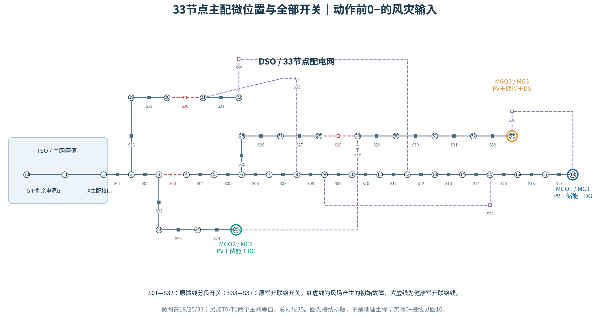

# 主配微韧性恢复：原三个创新点的台风动态故障仿真版

**r2完整包：[下载独立运行ZIP](https://github.com/mw618cn/-/raw/refs/heads/main/downloads/tdm_typhoon_33_r2.zip)**

已有台风33节点版：[下载覆盖替换包](https://github.com/mw618cn/-/raw/refs/heads/main/downloads/tdm_typhoon_33_r2_patch.zip)，操作见[替换说明](typhoon_version/替换说明.md)。

完整解压，只运行main.py，只维护一份参数数据.xlsx：

```bash
python -m pip install -r requirements.txt
python main.py
```

保留三个研究点：①启动／等待决策边界；②多时段可分解支撑能力域；③信息驱动的抢修—重构—启动协同。台风只是场景输入，不新增第四个创新点。

最新源代码在 [typhoon_version](typhoon_version/)，仓库根main.py也默认调用它。完整代码/表格说明见[使用说明](typhoon_version/README.md)，三点对应关系见[创新点与代码](typhoon_version/三个创新点与代码对应.md)。

- D1—D33配网＋T0/T1主网等值，3个微网在18/25/33；24h/96个15分钟调度时段。
- 移动简化风场驱动动态多故障，37条配电线均暴露，含常开联络线；地理、脆弱性和道路为可替换合成参数。
- 通用带电森林，允许无源区失电；优化开关，约束动作预算和保持时间。
- 一队伍优化当前已报告任务，巡检后揭示轻重，天气不安全暂停并保留进度；滚动继承SOC与承诺。
- 最大加权恢复面积为主，成本为次；D估计、求解区间和实际执行收益分开。
- 显式MGO–DSO接口和滚动跨期能量包络进入统一优化；内部状态保留以保证分解。
- 局部微网条件资源域与初始预测网络可送范围分开；D相图每格重新优化两分支。
- r2始终比较充/放电候选，并保留更好的可行恢复水平；新增模式邻域、求解质量和禁反送对照。



仍用集中式HiGHS MILP＋条件LP，ADMM未实现。有限预测场景、未知工时上界及短限时滚动不构成完整POMDP最优策略证明。示例对照与未判区如实输出，不保证联合策略在每个样本优于规则基线。

验证及实际示例见[r2验证预览](docs/preview_typhoon_r2/README.md)。保留[固定初始故障33节点旧版](ieee33_version/)及[6节点旧版](simple_version/)，其结果不作为台风动态多故障仿真结果。
