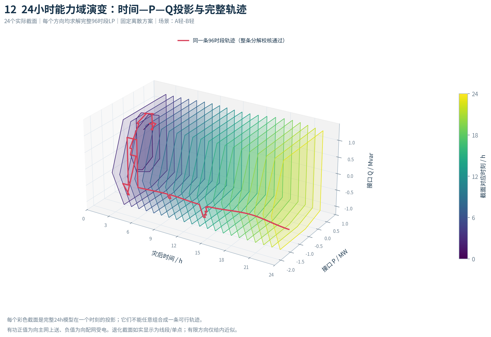
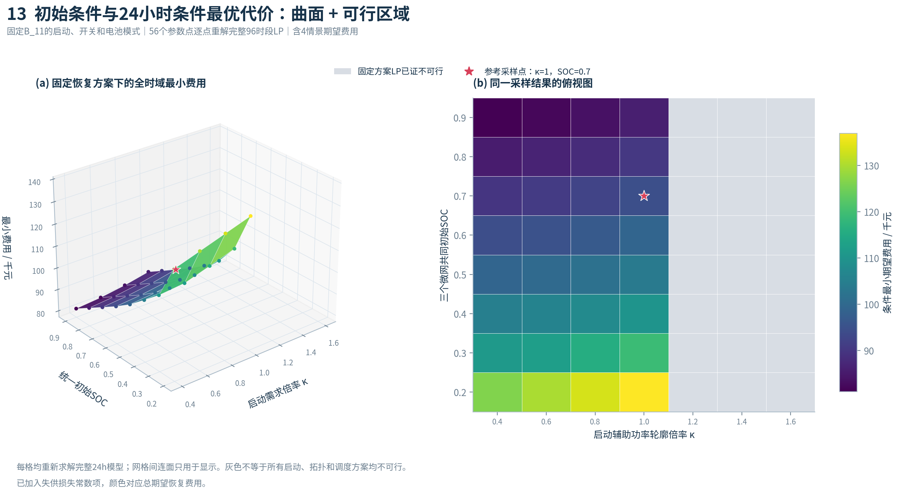

# 主配微协同韧性恢复：运行main.py即可

**推荐下载：[简明版代码ZIP](https://github.com/mw618cn/-/raw/refs/heads/main/downloads/tdm_simple.zip)。**

简明版只有7个Python文件和1份Excel参数。解压后先安装一次依赖：

```bash
python -m pip install -r requirements.txt
```

然后直接在PyCharm/VS Code里运行 **main.py**，或执行：

```bash
python main.py
```

## 简明版文件结构

```text
main.py             主程序：读取参数→建模→求解→校核→出图
参数数据.xlsx         唯一参数数据表；以后改参数只改它
data.py            读写Excel、整理96时段数据
repair_model.py    巡检/抢修/路程/场景信息模型
power_model.py     网络/微网/储能/机组启动模型及求解器
analysis.py        D值、韧性指标、能力域、分解和结果校核
rolling.py         滚动调度
plots.py           结果绘图
requirements.txt    第三方依赖
README.md           使用说明
```

Excel的“运行设置”控制是否计算启动/等待比较、能力域、滚动回放和基线。无需命令行选项，主程序自动调用其余模块。

默认会计算24小时、96时段、4损伤场景与8种有限因果抢修策略。微网参数、节点负荷、线路容量、巡检/维修时间、启动曲线和96点数据全部在Excel中。

计算完成先看 **结果汇总.xlsx** 和 **figures/**。每次运行自动保留所用参数，结果分别存放，避免混用。

## 如果下载整个仓库

仓库根目录的 `main.py` 也可直接运行；参数表位于 `simple_version/参数数据.xlsx`。简明版的实际模块都在 [simple_version](simple_version/) 文件夹。

完整函数与表格说明见 [简明版README](simple_version/README.md)。原来的包结构、论文Word生成器和批量扫描工具继续保留，详细用法见 [进阶使用说明](docs/advanced_usage.md)。日常建模运行使用简明版即可。

模型是自设参数研究原型：集中式HiGHS MILP、线性网络、条件能力域与固定队伍策略滚动。简明版保留同一套24h物理和信息约束，参数表对读入值进行校验。

## 全天能力图与条件代价图

新版默认增加图12（24个整点能力截面+同一96时段轨迹）及图13（启动需求倍率/SOC的条件费用与可行性）。模型仍为完整24h；图08只是三个代表时刻诊断。Excel的capability_interval_hours改0.25可查询96个截面，旧版Excel也兼容。





上图来自实际LP计算。图13灰色仅代表固定恢复方案下不可行，不能推广成全部混合整数恢复策略的不可行域。数据与校核说明见[示例数据](docs/preview/README.md)。
