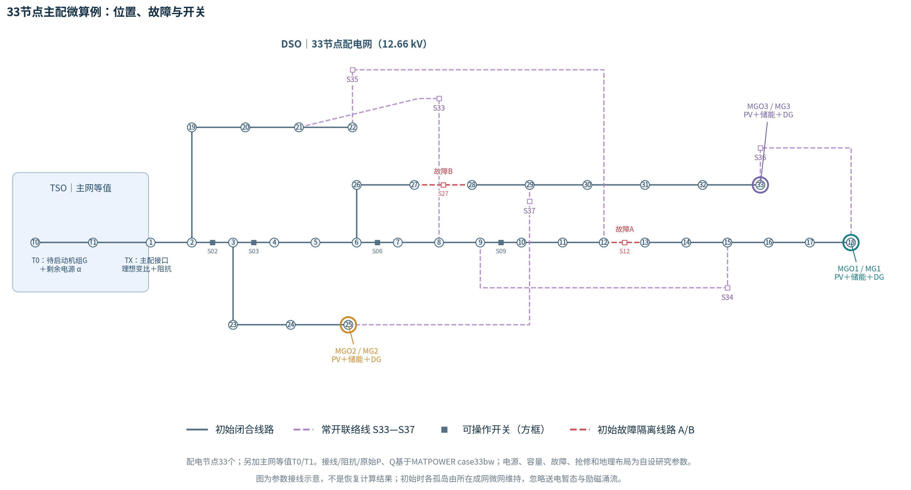

# 33节点主配微协同韧性恢复

**最新代码包：[下载33节点版ZIP](https://github.com/mw618cn/-/raw/refs/heads/main/downloads/tdm_ieee33.zip)**

完整解压后安装依赖，再运行main.py：

```bash
python -m pip install -r requirements.txt
python main.py
```

只有一个运行入口和一份Excel参数。仓库根目录main.py默认调用ieee33_version；单独下载ZIP不需要其余仓库文件。

网络是 **D1—D33配电网＋T0/T1主网等值＋D18/D25/D33三个微网**，35个总母线、39支路。标明A=12—13、B=27—28故障线路及五个常开联络开关。原始33节点接线、阻抗和Pd/Qd来自MATPOWER case33bw；其余研究参数均在Excel中，可替换。



上图为参数接线示意。运行main.py后还会按真实可行解生成接线快照和96时段开关热图。

本版保留24h/96时段、4损伤场景、SOC、启动轮廓及条件非预期性。拓扑在Excel的32个经校核径向森林中选择，抢修在有限因果策略菜单中比较；不宣称覆盖所有开关组合和任意抢修路线。当前仍是集中式HiGHS MILP，ADMM未实现。

首次默认B_11策略、比较启动/等待，每个MILP限时90秒；能力域、条件代价面、滚动和基线默认关闭，可在Excel逐项开启。D值仅在所选策略和接线菜单内解释；界区间跨零不得声称已判定。完整参数说明、代码逻辑和当前边界见 [33节点使用说明](ieee33_version/README.md)。

源代码在 [ieee33_version](ieee33_version/)。[6节点旧版](simple_version/)和[旧代码ZIP](https://github.com/mw618cn/-/raw/refs/heads/main/downloads/tdm_simple_24h.zip)保留作机制验证，旧图不作为33节点结果。高级包和论文文档生成脚本见 [进阶使用说明](docs/advanced_usage.md)。
