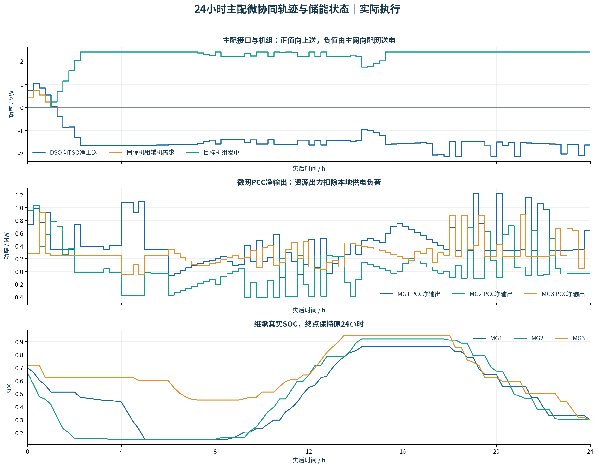
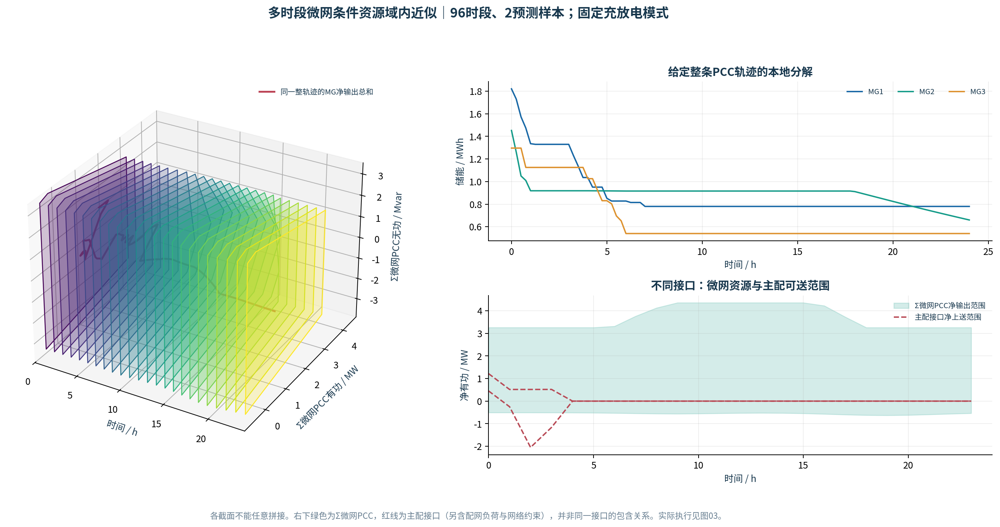
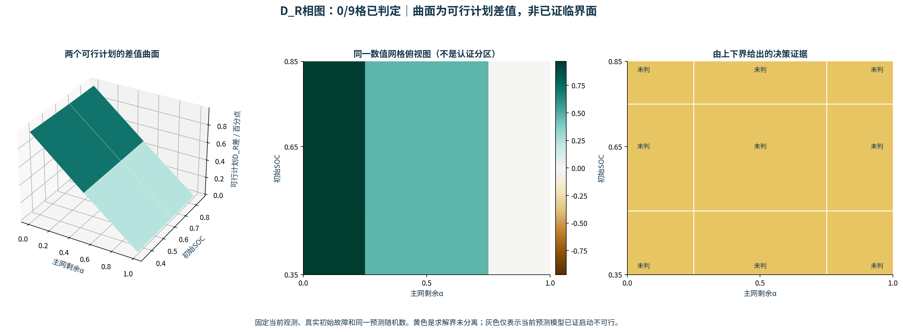
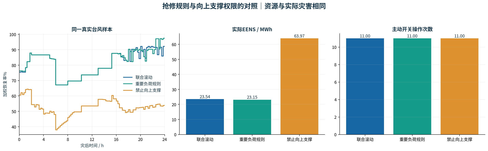

# r2 修复版验证预览

原三个研究点保留：启动/等待边界、多时段可分解支撑能力、信息驱动的抢修—重构—启动。台风仅为外生场景。

本轮默认预算下，联合滚动恢复面积比81.1731%，重要负荷抢修规则81.4352%，禁止向上支撑52.5430%。联合策略没有优于规则，未人为拉开优势。禁反送对照只检验向上支撑权限，不是完全无协同系统。

资源域保留完整96时段及跨期SOC；固定充放电模式后，支持点凸包构成截面内近似。红线主配接口范围与绿色Σ微网接口范围口径不同；主配通道隔离不代表微网没有资源。各时刻截面不能任意拼接。

D估计是已取得的可行计划之差；只有求解上下界分离才形成判据。未判网格不能据此宣布最优决策分区或临界值。代码修复不保证有限预算一定得到论文需要的临界面。

详细验证与边界见[验证说明](../../typhoon_version/验证说明.md)，[替换步骤](../../typhoon_version/替换说明.md)。采用集中式MILP＋局部条件LP，尚无ADMM。
